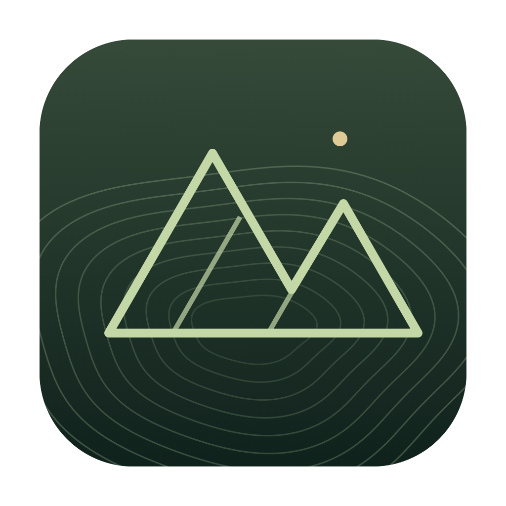

# Loci

A private landscape for notes, articles, links, and ideas. Explore the same collection as a 2D atlas or a 3D terrain, with related ideas nearby and unrelated ideas farther apart.

## Ideas in Space

We save things because they matter, then lose track of them as our collections grow. Search helps when we remember a title, a phrase, or even the right question. **Ideas in Space** gives us another way back: a place to explore, where the surroundings of an idea can help us recognize it again. Memory recovery here means rediscovering saved knowledge that has slipped out of everyday awareness.

### A brief history: the Method of Loci

The name **Loci** comes from the Latin word for places. The **Method of Loci**, also known as the memory palace, associates things we want to remember with locations along a familiar route. To recall them, we mentally revisit those places and retrieve the images or ideas attached to them. [Stanford's guide to the memory palace](https://ctl.stanford.edu/memory-strategy-memory-palace) describes how familiar locations, a planned route, and personal imagery support this practice.

The technique has roots in ancient Greek and Roman traditions of memory and rhetoric. In *De Oratore*, Cicero recounts the traditional origin story of the Greek poet Simonides of Ceos: after a banquet hall collapsed, Simonides was said to identify the victims by remembering where each guest had been seated. This origin legend connects the arrangement of places with the retrieval of memories. Cicero goes on to describe placing mental images in chosen locations to preserve the order of what one wishes to remember. See [*De Oratore*, II.86.351–354](https://www.laits.utexas.edu/memoria/Cicero.html).

### Further inspiration: Moonwalking with Einstein

Joshua Foer's [*Moonwalking with Einstein: The Art and Science of Remembering Everything*](https://www.penguinrandomhouse.com/books/301277/moonwalking-with-einstein-by-joshua-foer/) is a personal favorite and a companion to the ideas behind Loci. The book follows his year of training with competitive memorizers, weaving his experience together with the history of memory techniques and research into how we remember. Its exploration of imagery, association, and memory palaces offers an approachable introduction to giving ideas memorable places. Loci brings that spatial inspiration to the exploration of saved notes.

### A landscape for rediscovery

Loci adapts this spatial idea to a personal knowledge collection. Notes become places to visit. Similar ideas lie near one another, broader themes form regions, and higher terrain marks denser concentrations of related thoughts. Connections trace paths across the surface. The same geography can be explored as a 2D atlas or a 3D landscape, giving each idea a surrounding context as well as its own contents.

You might enter a region through a recent note about maps, follow a connection to an older article about spatial memory, and encounter a project idea you had forgotten saving. The aim is to turn browsing into a source of retrieval cues: remember a neighborhood, recognize a nearby thought, and follow it back to something worth recovering. The app uses this mnemonic tradition as a design inspiration for rediscovery.



## Run

The frontend is Vanilla JavaScript. A shared Rust core provides SQLite full-text/vector search, graph traversal, transactional imports, and embedding-cache validation. Tauri 2 supplies the native desktop shell; Axum serves the same interface in browser mode. Node and Python are not runtime requirements for the packaged applications.

### Build prerequisites

Install Rust and the [Tauri platform prerequisites](https://v2.tauri.app/start/prerequisites/). Node is needed only to prepare the existing Transformers.js/model assets and run the build-time CLI.

```sh
npm ci --ignore-scripts
npm run setup:embeddings
```

There is one runtime JavaScript dependency, `@huggingface/transformers`, and one build-time CLI, `@tauri-apps/cli`. The pinned Cargo lockfile supplies Rust dependencies. No frontend bundler or framework is used.

### Desktop

```sh
npm run dev
npm run build -- --bundles app
```

The Mac application is `target/release/bundle/macos/Loci.app`. Build on Windows or Linux for those native packages. The current local build targets Apple Silicon. Tauri uses WebView2 on Windows, WKWebView on macOS, and WebKitGTK on Linux; WebGPU availability depends on the OS/webview and graphics driver, with WebGL and Canvas fallbacks.

The package includes its interface, model, ONNX runtime, and Dock icon. Recipients do not need TinyJS, Node, Python, npm, or Ollama.

### Browser / headless server

```sh
node scripts/prepare-web.js
cargo run -p loci-server --release -- --bind 127.0.0.1:4173
# Or: npm start
```

Open <http://127.0.0.1:4173>. The release executable `target/release/loci-server` embeds the frontend and model assets and can run without the source checkout or Node. Use `--data /path/to/library.sqlite` (or `LOCI_DB`) to choose a database and `--bind` (or `LOCI_BIND`) to choose a loopback listener. Default storage is `data/loci-rust.sqlite` relative to the working directory.

For access from another machine, use SSH local port forwarding and open the forwarded localhost address in your browser. The listener and request-origin checks intentionally allow loopback access only. This remains a single-user library; multi-user isolation is not implemented. Native filesystem dialogs and Apple Notes automation are desktop capabilities; browser imports use file/folder uploads.

### Existing collection migration

The desktop opens `loci-rust.sqlite` in the existing OS application data folder. On first launch, it uses SQLite's online backup API to copy the legacy `loci.sqlite`, including committed WAL data. Server mode similarly copies a sibling legacy `loci.sqlite` when its new database does not yet exist. Original databases and source notes stay intact. Later edits in the old and new apps are not synchronized.

Existing note IDs, text, bookmarks, links, and embedding fingerprints are preserved. Matching vectors are indexed in sqlite-vec tables separated by model and dimensions. Note JSON retains its vectors for compatibility with the current frontend layout. `similarNotes` provides database-level cosine nearest-neighbor queries; FTS5 handles keyword search and recursive SQL handles graph traversal.

### Earlier implementation

The earlier TinyJS implementation has been removed. Its `loci.sqlite` databases are migrated on first launch (above) and its exported JSON collections remain importable. See [TODO.md](TODO.md) for the LanceDB, SurrealDB, and Rust FastEmbed evaluations.

## Bring notes in

Use **Import your knowledge**:

- **Apple Notes:** the standalone Mac app reads active, unlocked notes through macOS automation. macOS may request access. Plain text is imported; attachments, locked notes, and Recently Deleted are excluded. The original notes are never edited. On Windows or Linux, import a Loci backup exported on a Mac.
- **Obsidian vault:** select a folder. Markdown, YAML tags, inline tags, and `[[wikilinks]]`, including aliases and headings, are recognized. Native import skips hidden folders and symbolic links. Browser mode uploads selected text files to your own server.
- **Markdown / text:** select one or more files.
- **Loci collection:** restore a JSON export. Export under Settings.

Imports are snapshots, not automatic synchronization. Reimporting a source updates its imported copy. The current safety limits are 5,000 notes per collection, 2 MB per note, and 50 MB per server request. Originals are never overwritten. Imported personal data is ignored by Git and never embedded in the application bundle.

Use the first-run migration or import notes/JSON through the application. Reimporting unchanged notes keeps cached embeddings; editing content invalidates them. Vault notes are identified by their path inside the vault folder (`<folder name>/<file>`), the same on desktop and in the browser, so moving the vault on disk does not duplicate notes. Collections with older `vault:<absolute path>:<file>` IDs are re-keyed once on open; if a note was already re-imported under its new ID, the older copy is dropped.

## Explore

- **Appearance:** choose Light mode or Dark mode in Settings. The choice is saved on this device and applies to the interface and rendered map.
- **XYZ scaling:** enable it in Settings to adjust X width and Y depth independently (0.5×–3×), and Z height (0.25×–3×). Height applies in 3D; both views share X/Y scaling. Preferences are saved on this device. Reset scaling restores the defaults; Fit landscape accounts for the active scales.
- **Hill base:** a separate slider (0.5×–4×, default 2.5×) widens the footprint of every hill without moving notes. At the default, neighbouring hills run together into one meadow; contour rings follow the merged surface, so blended hills share an outline. Lower it for separate mountains.
- **2D Atlas:** flat overhead navigation, panning, zooming, and selectable notes.
- **3D Terrain:** real elevated mesh with depth testing, orbit, tilt, pan, and zoom. Right-drag, Alt-drag, or Shift-drag to orbit; the visible camera buttons work without a mouse gesture.
- **Drag:** pan. **Scroll:** zoom. **Fit landscape:** reset camera.
- **Find a thought / Cmd or Ctrl+K:** full-text search through SQLite FTS5. A LIKE fallback is available when a runtime lacks FTS5.
- **Nearby thoughts:** explicit links and inferred similarities. Bookmarks, recently added, note editing, quick capture, and external source links are available.
- **A little serendipity:** revisit a randomly selected saved note.

Terrain fills grade by elevation band from low blue ground through mauve to a rose summit. Contour rings grade from a bright, pale base ring to a warm orange summit ring; blue note connections stay distinct in both themes. Contour spacing is at least twice the original interval and widens on tall terrain so a summit carries about twelve rings at most; text and layout spacing are preserved. WebGPU renders the terrain where available, with WebGL and Canvas fallbacks. Connections are sampled at the actual terrain mesh boundaries, lifted slightly above the surface, and rendered with GPU depth testing. They rise over ridges and dip into valleys instead of using screen-space chords. Camera rotation, tilt, and 2D mode use the same world-space paths. The Canvas compatibility renderer uses the same camera projection but does not provide GPU depth-buffer occlusion.

## Meaning, distance, and elevation

Use Settings → **Refine semantic landscape** to embed notes in a worker with the bundled Sentence Transformer. WebGPU inference is attempted first, followed by local WASM/CPU. Long notes are split into overlapping token windows instead of silently embedding only the beginning. Normalized chunk vectors are averaged into one vector per note. Rust stores vectors in model-specific sqlite-vec tables alongside the notes, model identity, and content fingerprints. Editing a note invalidates its embedding; refine again after imports or edits.

Map similarity combines embeddings, weighted vocabulary, shared tags, and explicit links. Semantic regions use adaptive farthest-first seeds followed by spherical k-means, with tags and vocabulary as the fallback. The seed rule grows regions while the least-covered note has cosine similarity below 0.12 to every existing seed; this is a heuristic for broad topic discovery, not a calibrated relevance cutoff. Region labels favor note titles. A safety cap of 64 regions bounds clustering work; larger collections may need a multilevel atlas.

An iterative stress layout arranges related notes and regions near one another. A second pass spreads individual notes over each region’s slopes with collision separation, keeps those note clouds inside their own hill footprints, separates those footprints with wider valleys, and spreads the result across a broader map. The initial camera and Fit landscape frame the actual region bounds. Each region has broad, smoothly rounded hills whose contribution fades into gently rolling meadow ground outside its footprint. A hill's height is proportional to its share of notes (`0.5 + 2.5 × count / largest count`, so the largest region is about four times the height of a region a tenth its size) and its footprint grows with a softer curve of the same share, so the regions with the most ideas stand tallest and widest. Broad shoulders, subtle directional shading, and lower default vertical exaggeration create a landscape for wandering rather than needle-like peaks, while unrelated regions remain separated by low valleys. A stronger semantic relationship still influences where regions sit relative to each other, subject to the space needed to show separate mountains. Both 2D and 3D use identical base coordinates; the optional XYZ controls change display proportions without changing stored relationships.

Elevations reflect how many notes a region holds, not importance or accuracy. Positions are deterministic for an unchanged collection. Projection, clustering, and the space reserved for mountains distort some relationships; distances are approximate, not a calibrated semantic metric. The implementation is a small stress solver, not a claimed implementation of PaCMAP or LocalMAP.

The default model is the compact English `all-MiniLM-L6-v2` (384 dimensions, about 23 MB quantized weights). It is an economical baseline, not the newest or best multilingual model. The ONNX runtimes add roughly 39 MB, including the older-webview CPU fallback. No Python or PyTorch is shipped.

**Ollama is optional.** Settings → **Use a larger local model** uses an already-installed local `qwen3-embedding` model, or falls back to `nomic-embed-text`, over loopback. It never downloads a model or contacts a remote inference endpoint. The default embedded path does not need this service. Different embedding models are never compared directly. Use the embedded indexing button in Settings for the Rust app.

For more than 600 notes, the dependency-free layout uses sampled candidate pairs plus explicit links instead of calculating every pair. That limits nearest-neighbor accuracy for larger collections; an ANN index is the next upgrade if large-vault quality becomes a priority.

## Research reviewed — November 2026

These primary sources informed the implementation and model tradeoffs:

| Source | Relevance to Loci |
| --- | --- |
| [Sentence Transformers documentation](https://sbert.net/) | Pretrained embeddings and cosine similarity provide semantic relationships beyond exact words. The Python library is a suitable server alternative but adds an interpreter and ML runtime. |
| [Transformers.js documentation](https://huggingface.co/docs/transformers.js/en/index) and [WebGPU guide](https://huggingface.co/docs/transformers.js/en/guides/webgpu) | Run compatible sentence models locally in Vanilla JS, with GPU or WASM execution. |
| [EmbeddingGemma 2, October 2026](https://arxiv.org/abs/2610.37364) and [developer guide](https://developers.googleblog.com/en/embeddinggemma-2-the-developer-guide/) | A current candidate for a stronger, multilingual and eventually multimodal local model; modular text-only execution reduces its footprint. Not bundled by default because the compact baseline keeps installation smaller. |
| [Granite Embedding Multilingual R2, May 2026](https://arxiv.org/abs/2605.13521) | Compact multilingual encoders are worth evaluating if the collection extends beyond English. Benchmark claims do not replace evaluation on personal notes. |
| [Qwen3 Embedding, June 2025](https://arxiv.org/abs/2506.05176) | A stronger optional local model family, with deployment/latency tradeoffs across model sizes. |
| [PaCMAP, JMLR 2021](https://www.jmlr.org/beta/papers/v22/20-1061.html) | Preserve local relationships and broader structure rather than treating a layout as decorative clusters. |
| [LocalMAP, AAAI 2025](https://ojs.aaai.org/index.php/AAAI/article/view/35436) | Neighborhood graphs can contain misleading edges; visual clusters are not ground truth. |
| [MiniLM model card](https://huggingface.co/sentence-transformers/all-MiniLM-L6-v2) | The selected model's intended use, English focus, embedding size, and input-length limit motivate token-window chunking. |
| [Nomic model card](https://huggingface.co/nomic-ai/nomic-embed-text-v1.5) | Optional Ollama indexing uses its documented symmetric `clustering:` prefix; Qwen note-to-note indexing uses plain text. |

Model choice should ultimately be evaluated on a small set of user-labelled related/unrelated note pairs, including paraphrases, technical identifiers, multilingual passages, and multi-topic notes. No benchmark score is presented as an evaluation of this personal collection.

## Checks

```sh
npm test
node scripts/prepare-web.js
cargo test --workspace
```

JavaScript checks cover Markdown/Obsidian parsing, ambiguity in links, deterministic semantic layout, the shared content fingerprint, camera projection, XYZ preference validation and depth bounds, separated mountain footprints, and terrain-following connection geometry. Rust checks cover FTS5, cosine vector search and model isolation, graph traversal, transactional rollback, cache preservation, migration safety (including a stale vector that must not block opening), vault scanning, and HTTP host/origin boundaries.

The retained frontend smoke tests exercise actual WebGPU, WebGL, Canvas, and embedded model inference when run through the app's asset origin. Cross-platform native packaging and real-driver GPU behavior must be checked on their target operating systems.
